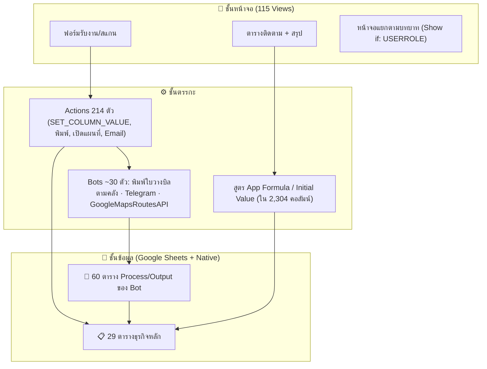
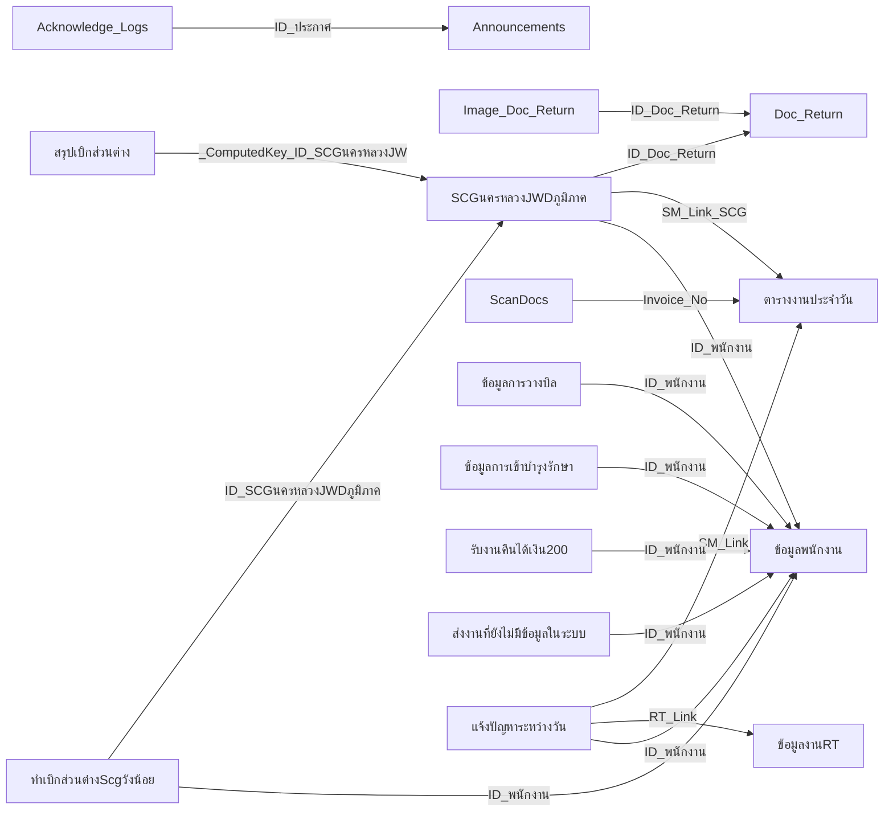

# สถาปัตยกรรมแอป (Architecture)

## ภาพรวม 3 ชั้น



## แผนภาพความสัมพันธ์ของตารางหลัก (Ref Relations)

เส้นเชื่อมด้านล่างอ่านจากคอลัมน์ชนิด `Ref` ในเอกสารจริงทั้งหมด (16 เส้น ระหว่างตารางหลัก) ลูกศรชี้จาก "ตารางที่มีคอลัมน์ Ref" ไปหา "ตารางที่ถูกอ้างถึง"



ตารางหลักที่ไม่มี Ref เชื่อม (ใช้แบบสแตนด์อโลนหรือเชื่อมผ่านสูตร SELECT แทน): `ราคาน้ำมันดีเซล`, `ราคาในระบบก่อนส่งสินค้า`, `หน้าหลัก`, `ปริ๊นใบวางบิล`, `PDFพนักงาน`, `FILTER`, `ข้อมูลชื่องานต้นทางปลายทาง`, `ข้อมูลงานRW`, `สร้างเอกสาร`, `สรุป_เจ้าของสินค้า`, `สรุป_Shipment`, `PriceOverride`, `Price_Table`

## โมเดลสิทธิ์ผู้ใช้

```mermaid
flowchart TB
  U["👤 USER (พนักงาน)"] -->|เห็นเฉพาะแถวที่ [Email พนักงาน] = USEREMAIL| D["ตารางที่มี Security Filter"]
  U -->|ADDS_AND_UPDATES ลบไม่ได้| D
  A["👑 ADMIN"] -->|ALL_CHANGES + เห็นทุกแถว| D
  R["ระดับอื่น"] -->|READ_ONLY| D
```

ตารางที่ใช้ Security Filter รูปแบบ `=OR(USERROLE() = "ADMIN", [Email พนักงาน] = USEREMAIL())`: ดูรายการเต็มใน `docs/00_APP_OVERVIEW.md` และใน README ของแต่ละตาราง

## ชั้นระบบอัตโนมัติ (Bots)

สรุปกลุ่มงานอัตโนมัติจากร่องรอย Process/Output Tables (รายละเอียดเต็มใน [docs/06](docs/06_BOTS_AND_PROCESS_TABLES.md)):

| กลุ่มงาน | จำนวน (สันนิษฐาน) | เทคโนโลยีที่พบ |
|---|---:|---|
| พิมพ์ใบวางบิลแยกตามคลัง/ลูกค้า | ~12 | PDF/Printer Task |
| จัดเส้นทาง/คำนวณค่าส่งตามระยะทาง | 2 | GoogleMapsRoutesAPI |
| เบิกค่า/ส่วนต่าง/ค่ายกขึ้นชั้น | ~5 | Data Actions + สรุป |
| แจ้งเตือน/สื่อสาร | ~3 | Telegram, AppSheet_KM |
| สแกน/รับคืน/เอกสาร | ~4 | ScanStatus, Doc_Return |
| โอนคลัง (GQ จีคิว, MeSpace) | ~2 | Data Actions |

## ความสัมพันธ์ View ↔ ข้อมูล

- View ที่ map กับตาราง/slice ได้: **107/115** (อีก 8 เป็น view ระดับแอป เช่น dashboard)
- ชนิด View ที่ใช้มากที่สุด: `detail` (38), `form` (36), `table` (32), `deck` (8), `gallery` (1)

