# Bots และตาราง Process/Output (ระบบอัตโนมัติ)

## ทำความเข้าใจสิ่งที่เห็นในเอกสารนี้ก่อน

เมื่อสร้าง **Bot** ใน AppSheet Automation แล้ว AppSheet จะสร้าง "ตารางภายใน" ให้โดยอัตโนมัติ 2 กลุ่ม คือ **Process Table** (เก็บสถานะการทำงานของ process ชื่อขึ้นต้น `Process for ...`) และ **Output Table** (เก็บผลลัพธ์ของแต่ละ step ชื่อลงท้าย `Output`) ตารางกลุ่มนี้เป็น native table (อยู่ในตัว AppSheet ไม่ใช่ Google Sheets) ผู้ใช้มองไม่เห็นในแอป และแก้ไขไม่ได้

เอกสาร documentation ของ AppSheet **ไม่ได้ export นิยามของ Bot** (Event, Process, Task) มาให้ แต่จากชื่อตาราง + ความสัมพันธ์ Ref เราสรุปร่องรอยของแต่ละ Bot ได้ดังนี้ เมื่อต้องการนิยามเต็มต้องเปิดดูใน AppSheet Editor → Automation

รวม **30 Process Tables** และ **30 Output Tables**

## แผนผังความสัมพันธ์ Process Table ↔ Output Table

แต่ละ Process Table มีคอลัมน์แบบ Ref ชี้ไปยัง Output Table ของ step ต่าง ๆ ความสัมพันธ์เหล่านี้ถูกอ่านจากชนิดคอลัมน์ `Ref` ใน schema ของแต่ละตาราง

```mermaid
flowchart LR
  P1["🤖 Process for ปริ๊นใบวางบิล Process Table"]
  P1 --> O1_1["ปริ๊นใบวางบิล_step Output"]
  P2["🤖 Process for Telegram_แจ้งปัญหา - 1 Proce"]
  P2 --> O2_1["ตารางงานประจำวัน"]
  P2 --> O2_2["ข้อมูลงานRT"]
  P2 --> O2_3["ข้อมูลพนักงาน"]
  P2 --> O2_4["Telegram_แจ้งปัญหา2 Output"]
  P3["🤖 Process for Bot_รับสินค้าคืน - 1 Process"]
  P3 --> O3_1["ข้อมูลพนักงาน"]
  P3 --> O3_2["เข้ารับสินค้าคืน Output"]
  P4["🤖 Process for เพิ่มรูปรับคืน - 1 Process T"]
  P4 --> O4_1["ข้อมูลพนักงาน"]
  P4 --> O4_2["New step Output"]
  P5["🤖 Process for ปริ๊นใบวางบิลเอเทน - 1 Proce"]
  P5 --> O5_1["Clear Output"]
  P6["🤖 Process for สรุปส่วนต่าง - 1 Process Tab"]
  P6 --> O6_1["SCGนครหลวงJWDภูมิภาค"]
  P7["🤖 Process for สรุปจำนวนจุดที่ส่งงานSCGวังน"]
  P7 --> O7_1["เคลียสรุปจุดส่ง Output"]
  P8["🤖 Process for ปริ๊นใบวางบิลโอนคลัง มโนยนต์"]
  P8 --> O8_1["Clear Output 2"]
  P9["🤖 Process for ปริ๊นใบวางบิล_โอนคลัง กระสอบ"]
  P9 --> O9_1["Clear Output 3"]
  P10["🤖 Process for ปริ๊นใบวางบิล_ไอโรบอท Proces"]
  P10 --> O10_1["Clear Output 4"]
  P11["🤖 Process for ปริ๊นใบวางบิล_โอนคลัง เอเธน "]
  P11 --> O11_1["Clear Output 5"]
  P12["🤖 Process for ปริ๊นใบวางบิล_รับเอกสาร งานพ"]
  P12 --> O12_1["Clear Output 6"]
  P13["🤖 Process for ปริ๊นใบวางบิล_รับเอกสาร งานพ"]
  P13 --> O13_1["Clear Output 7"]
  P14["🤖 Process for ฺBot_4ตัว_จัดเรียงเส้นทาง Pr"]
  P14 --> O14_1["SCGนครหลวงJWDภูมิภาค"]
  P14 --> O14_2["ข้อมูลพนักงาน"]
  P14 --> O14_3["GoogleMapsRoutesAPI_Step Output"]
  P15["🤖 Process for โอนคลัง GQ จีคิว Process Tab"]
  P15 --> O15_1["Clear Output 8"]
  P16["🤖 Process for MeSpace Process Table"]
  P16 --> O16_1["Clear Output 9"]
  P17["🤖 Process for ปริ๊นใบวางบิล_คลังSCGJWDวังน"]
  P17 --> O17_1["Clear Output 10"]
  P18["🤖 Process for ทำเบิกส่วนต่างScgวังน้อย - 1"]
  P18 --> O18_1["SCGนครหลวงJWDภูมิภาค"]
  P18 --> O18_2["ข้อมูลพนักงาน"]
  P18 --> O18_3["ทำเบิกส่วนต่างScgวังน้อยstep Output"]
  P18 --> O18_4["New step2 Output"]
  P18 --> O18_5["ไม่ผ่านNew step Output"]
  P19["🤖 Process for AppSheet_KM - 1 Process Tabl"]
  P19 --> O19_1["Doc_Return"]
  P19 --> O19_2["ตารางงานประจำวัน"]
  P19 --> O19_3["ข้อมูลพนักงาน"]
  P19 --> O19_4["AppSheet___KM Output"]
  P19 --> O19_5["New step Output 2"]
  P20["🤖 Process for New bot - 1 Process Table"]
  P20 --> O20_1["ตารางงานประจำวัน"]
  P20 --> O20_2["ข้อมูลงานRT"]
  P20 --> O20_3["ข้อมูลพนักงาน"]
  P20 --> O20_4["New step Output 3"]
  P21["🤖 Process for Update ScanStatus เมื่อสแกน "]
  P21 --> O21_1["ตารางงานประจำวัน"]
  P21 --> O21_2["Update Output"]
  P22["🤖 Process for ปริ๊นใบวางบิล_เบทาโกร+เหมาตู"]
  P22 --> O22_1["Clear Output 11"]
  P23["🤖 Process for ปริ๊นใบวางบิล_LINEMAN 6W SCG"]
  P23 --> O23_1["Clear Output 12"]
  P24["🤖 Process for ปริ๊นใบวางบิล_Thai paper SCG"]
  P24 --> O24_1["Clear Output 13"]
  P25["🤖 Process for ปริ๊นใบวางบิล_โอนคลัง บุญถาว"]
  P25 --> O25_1["Clear Output 14"]
  P26["🤖 Process for Bot_เบิกค่าขนส่งตามระยะทาง -"]
  P26 --> O26_1["SCGนครหลวงJWDภูมิภาค"]
  P26 --> O26_2["ข้อมูลพนักงาน"]
  P26 --> O26_3["เบิกตามระยะทาง Output"]
  P26 --> O26_4["New step4 Output"]
  P26 --> O26_5["New step3 Output"]
```

## รายชื่อ Bot ที่สันนิษฐานจากชื่อ Process Table

แต่ละแถวคือ Process Table 1 ตัว = 1 bot (หรือ 1 process) คอลัมน์ "Output ที่เกี่ยว" คือ step ที่ bot นั้นสร้างผลลัพธ์ทิ้งไว้

| Process Table (= Bot) | Output ที่เกี่ยวข้อง | คอลัมน์ทั้งหมด |
|---|---|---:|
| Process for ปริ๊นใบวางบิล Process Table | `ปริ๊นใบวางบิล_step Output` | 12 |
| Process for Telegram_แจ้งปัญหา - 1 Process Table | `Telegram_แจ้งปัญหา2 Output`, `ข้อมูลงานRT`, `ข้อมูลพนักงาน`, `ตารางงานประจำวัน` | 30 |
| Process for Bot_รับสินค้าคืน - 1 Process Table | `ข้อมูลพนักงาน`, `เข้ารับสินค้าคืน Output` | 30 |
| Process for เพิ่มรูปรับคืน - 1 Process Table | `New step Output`, `ข้อมูลพนักงาน` | 30 |
| Process for ใบป่ะหน้า - 1 Process Table | — | 11 |
| Process for ปริ๊นใบวางบิลเอเทน - 1 Process Table | `Clear Output` | 12 |
| Process for สรุปส่วนต่าง - 1 Process Table | `SCGนครหลวงJWDภูมิภาค` | 12 |
| Process for สรุปจำนวนจุดที่ส่งงานSCGวังน้อย Process Table | `เคลียสรุปจุดส่ง Output` | 15 |
| Process for ปริ๊นใบวางบิลโอนคลัง มโนยนต์ (นวนคร) Process Table | `Clear Output 2` | 12 |
| Process for ปริ๊นใบวางบิล_โอนคลัง กระสอบ2(บางบัวทอง) Process Table | `Clear Output 3` | 12 |
| Process for ปริ๊นใบวางบิล_ไอโรบอท Process Table | `Clear Output 4` | 12 |
| Process for ปริ๊นใบวางบิล_โอนคลัง เอเธน Process Table | `Clear Output 5` | 12 |
| Process for ปริ๊นใบวางบิล_รับเอกสาร (งานพี่เหน่ง) สตีเบล Process Table | `Clear Output 6` | 12 |
| Process for ปริ๊นใบวางบิล_รับเอกสาร (งานพี่เหน่ง) Process Table | `Clear Output 7` | 12 |
| Process for ฺBot_4ตัว_จัดเรียงเส้นทาง Process Table | `GoogleMapsRoutesAPI_Step Output`, `SCGนครหลวงJWDภูมิภาค`, `ข้อมูลพนักงาน` | 137 |
| Process for โอนคลัง (GQ) จีคิว Process Table | `Clear Output 8` | 12 |
| Process for MeSpace Process Table | `Clear Output 9` | 12 |
| Process for ปริ๊นใบวางบิล_คลังSCGJWDวังน้อย Process Table | `Clear Output 10` | 12 |
| Process for ได้เพิ่ม200_ไม่มีสินค้าคืน_ร้านปิด_ไม่มีในจุดส่ง Process Table | — | 14 |
| Process for ทำเบิกค่ายกขึ้นชั้น Process Table | — | 14 |
| Process for ได้เพิ่ม25%ของค่าเที่ยว Process Table | — | 14 |
| Process for ทำเบิกส่วนต่างScgวังน้อย - 1 Process Table | `New step2 Output`, `SCGนครหลวงJWDภูมิภาค`, `ข้อมูลพนักงาน`, `ทำเบิกส่วนต่างScgวังน้อยstep Output`, `ไม่ผ่านNew step Output` | 139 |
| Process for AppSheet_KM - 1 Process Table | `AppSheet___KM Output`, `Doc_Return`, `New step Output 2`, `ข้อมูลพนักงาน`, `ตารางงานประจำวัน` | 51 |
| Process for New bot - 1 Process Table | `New step Output 3`, `ข้อมูลงานRT`, `ข้อมูลพนักงาน`, `ตารางงานประจำวัน` | 30 |
| Process for Update ScanStatus เมื่อสแกน Invoice - 1 Process Table | `Update Output`, `ตารางงานประจำวัน` | 19 |
| Process for ปริ๊นใบวางบิล_เบทาโกร+เหมาตู้ Process Table | `Clear Output 11` | 12 |
| Process for ปริ๊นใบวางบิล_LINEMAN (6W) (SCG Express) Process Table | `Clear Output 12` | 12 |
| Process for ปริ๊นใบวางบิล_Thai paper (SCG Express) - 1 Process Table | `Clear Output 13` | 12 |
| Process for ปริ๊นใบวางบิล_โอนคลัง บุญถาวร เกษตร_นวมินทร์ - 1 Process Table | `Clear Output 14` | 12 |
| Process for Bot_เบิกค่าขนส่งตามระยะทาง - 1 Process Table | `New step3 Output`, `New step4 Output`, `SCGนครหลวงJWDภูมิภาค`, `ข้อมูลพนักงาน`, `เบิกตามระยะทาง Output` | 139 |

## กลุ่มงานที่สันนิษฐานจากชื่อ Bot

การตั้งชื่อบอกวัตถุประสงค์ของแต่ละ bot ไว้ชัดเจน จัดกลุ่มได้คร่าว ๆ ดังนี้ (หมายเหตุ: การจัดกลุ่มนี้อนุมานจากชื่อล้วน ๆ ยังไม่ได้ตรวจนิยามจริงใน editor)

| กลุ่มงาน | Bot ที่เกี่ยวข้อง (จากชื่อ) |
|---|---|
| 🖨️ พิมพ์ใบวางบิลแยกตามปลายทาง/คลัง | ปริ๊นใบวางบิล_โอนคลังมโนยนต์ (นวนคร), ปริ๊นใบวางบิล_โอนคลังกระสอบ2 (บางบัวทอง), ปริ๊นใบวางบิล_ไอโรบอท, ปริ๊นใบวางบิล_โอนคลัง เอเธน, ปริ๊นใบวางบิล_คลังSCGJWDวังน้อย, ปริ๊นใบวางบิลเอเทน, ปริ๊นใบวางบิล_เบทาโกร+เหมาตู้, ปริ๊นใบวางบิล_LINEMAN (6W) (SCG Express), ปริ๊นใบวางบิล_Thai paper (SCG Express), ปริ๊นใบวางบิล_รับเอกสาร (งานพี่เหน่ง), ปริ๊นใบวางบิล_รับเอกสาร (งานพี่เหน่ง) สตีเบิล, ปริ๊นใบวางบิล |
| 🗺️ จัดเส้นทาง / คำนวณระยะทาง | Bot_4ตัว_จัดเรียงเส้นทาง (ใช้ GoogleMapsRoutesAPI), Bot_เบิกค่าขนส่งตามระยะทาง |
| 💰 เบิกค่าใช้จ่าย/ส่วนต่าง | ทำเบิกส่วนต่างScgวังน้อย, สรุปส่วนต่าง, ทำเบิกค่ายกขึ้นชั้น, ได้เพิ่ม200_ไม่มีสินค้าคืน_ร้านปิด_ไม่มีในจุดส่ง, ได้เพิ่ม25%ของค่าเทีย่ว |
| 📦 โอนคลัง | โอนคลัง (GQ) จีคิว, MeSpace |
| 📷 รับสินค้าคืน/เอกสาร | Bot_รับสินค้าคืน, เพิ่มรูปรับคืน, Update ScanStatus เมื่อสแกน Invoice |
| 📢 แจ้งเตือน/สื่อสาร | Telegram_แจ้งปัญหา (Telegram_แจ้งปัญหา2 Output), AppSheet_KM, New bot |
| 🧾 ใบปิดหน้า / สรุปงาน | ใบปิดหน้า, สรุปจำนวนจุดที่ส่งงานSCGวังน้อย, ทำเบิกส่วนต่างScgวังน้อย (step) |

## ตัวอย่างโครงสร้างคอลัมน์ของ Process Table

ทุก Process Table มีโครงสร้างคล้ายกัน: คอลัมน์ `_ComputedKey_ID_<ตารางหลัก>` (Ref กลับไปตารางข้อมูลจริง) คอลัมน์ Ref ไปยัง Output ของแต่ละ step และคอลัมน์สถานะของ step ตัวอย่างเช่น [Process for ปริ๊นใบวางบิล Process Table](../tables/T31_Process-for-ปริ๊นใบวางบิล-Process-Table/) และ [Process for Telegram_แจ้งปัญหา - 1 Process Table](../tables/T33_Process-for-Telegram_แจ้งปัญหา-1-Process-Table/)

